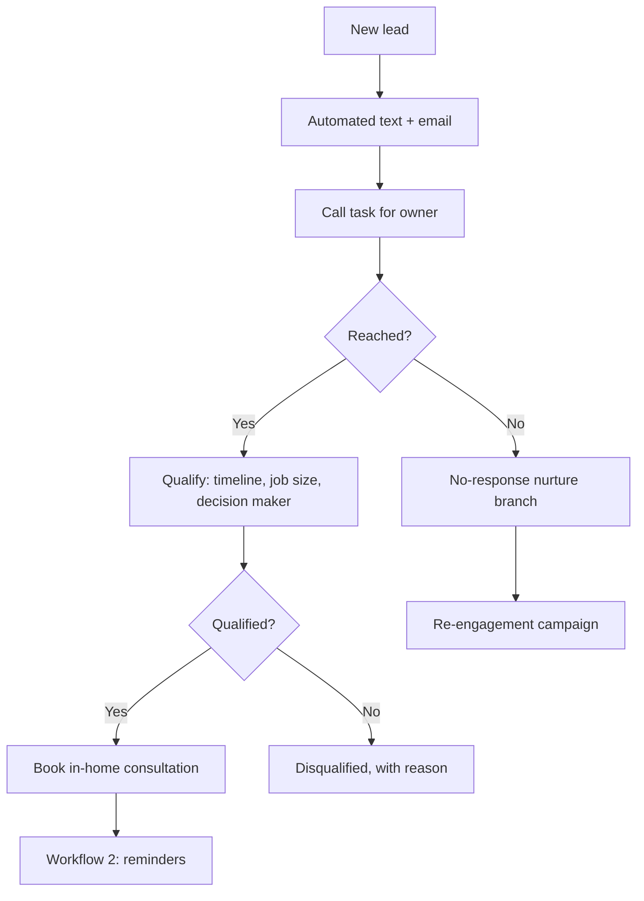

# 1. Lead intake, qualification and lifecycle

**Platform:** Zoho CRM, Zoho Flow, RingCentral (SMS and IVR), Zoho Mail
**Status:** Production. Replaced an earlier GoHighLevel workflow.

## Problem

Inbound leads waited too long for a first response, nobody checked whether a lead was a real buyer before booking a consultation, and leads had no defined status, so follow-up depended on memory.

## Trigger

A new lead is created from a web form, an inbound call, or manual entry.

## Actions

1. An automated text (RingCentral through Zoho Flow) and email (Zoho Mail) go out immediately.
2. A call task is created for the lead owner, so the human call follows the automated message within minutes.
3. The lead moves through a defined lifecycle as contact attempts are logged.
4. Before a consultation is booked, the lead is qualified on **timeline, job size and decision maker**.
5. Leads that never answer move to a no-response nurture branch: follow-up attempts, then a re-engagement campaign.
6. Qualified leads are booked into an in-home consultation, which starts workflow 2.

## Lead lifecycle

Six stages, with one owner and one definition each:

| Stage | Meaning |
|---|---|
| New Inquiry | Created, not yet contacted |
| Contact Attempted | At least one logged attempt |
| Awaiting Contact Information | Reached, missing details needed to qualify or book |
| Awaiting Neighbor Confirmation | Waiting on a neighbor's agreement before the job can proceed |
| Long Term Nurturing | Real prospect, not ready now |
| Disqualified | Closed, with a required reason from a picklist |

Disqualified leads carry a reason value (for example: submitted by accident, contractor or mystery shopper). Reporting depends on that field, see workflow 4.

## Human review

The owner makes the first call. The qualification questions are asked by a person. Disqualification reasons are chosen by a person, not inferred.

## Result

- First response averaged about 1.5 minutes in business hours (42 minutes including after-hours leads).
- Cancellations fell from about 50% to about 10%, together with the confirmation and reminder workflow (workflow 2) and scheduling coordination.
